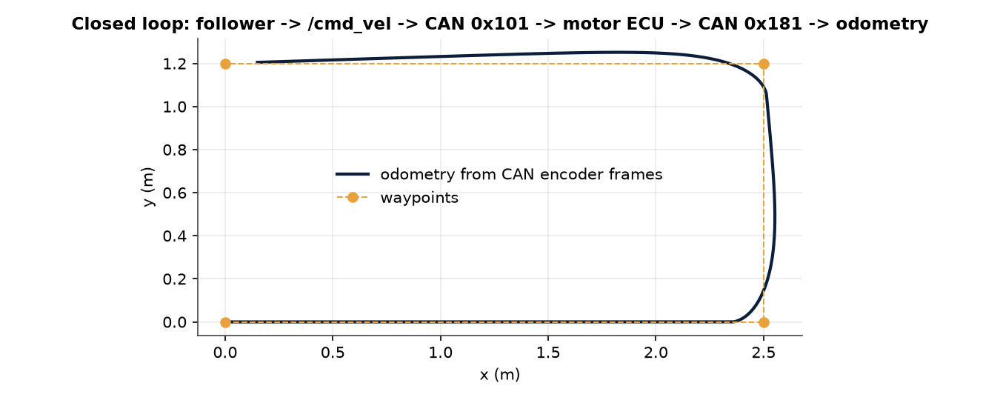
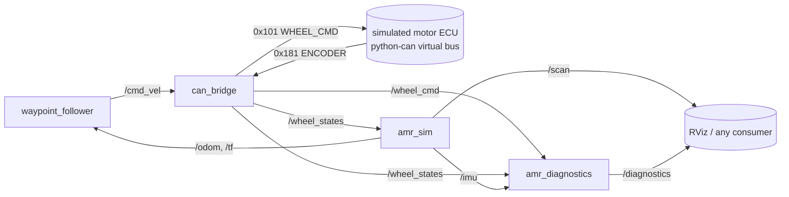

<p align="center">
  <picture>
    <source media="(prefers-color-scheme: dark)" srcset="assets/logo-dark.svg">
    
  </picture>
</p>

<p align="center">
  <b>A simulated ROS 2 robot whose wheels are driven over CAN.</b><br>
  Waypoint follower, CAN motor bridge and fault diagnostics for a differential-drive AMR. No robot needed: it all runs on a virtual CAN bus.
</p>

<p align="center">
  <a href="https://github.com/Alifizz01/RoverCAN/actions/workflows/ci.yml"></a>
  
  
  
</p>

<p align="center"></p>

> **Scope:** Simulated robot only: kinematics, no Gazebo/Nav2/SLAM, virtual CAN bus (not SocketCAN hardware), illustrative fault thresholds. Personal portfolio project, not affiliated with any employer.

---

## The problem

Robot software is usually tested either in a full simulator or on the real robot. The layer in between, where a `/cmd_vel` becomes motor CAN frames and encoder frames come back, is where counters, checksums and timeouts break, and it is rarely tested on its own.

## Overview

A small ROS 2 (Humble) Python package for a **simulated** differential-drive AMR:
a kinematic simulator, a waypoint follower, a CAN motor bridge that turns `/cmd_vel`
into wheel-speed CAN frames on a python-can virtual bus, and a diagnostics node
that flags injected faults on `/diagnostics`.

## Architecture



| Node | Subscribes | Publishes |
|---|---|---|
| `amr_sim` | `/wheel_states` | `/odom`, TF `odom -> base_link`, `/imu` (yaw rate), `/scan` (360 deg ray cast on a grid map) |
| `waypoint_follower` | `/odom` | `/cmd_vel` |
| `can_bridge` | `/cmd_vel` | CAN 0x101, `/wheel_cmd`, `/wheel_states` (from CAN 0x181) |
| `amr_diagnostics` | `/wheel_cmd`, `/wheel_states`, `/imu` | `/diagnostics` (`diagnostic_msgs/DiagnosticArray`) |

The pure-Python logic lives in `ros2_amr_bench/core/` (no `rclpy` import) and the
nodes are thin wrappers, so the core is unit-tested without ROS installed.

### CAN frames (8 bytes, little endian, XOR checksum in byte 7)

| ID | Direction | Bytes 0-1 | Bytes 2-3 | Byte 4 | Byte 5 | Byte 6 | Byte 7 |
|---|---|---|---|---|---|---|---|
| 0x101 WHEEL_CMD | bridge -> ECU | left int16 mrad/s | right int16 mrad/s | counter | 0 | 0 | XOR(0..6) |
| 0x181 ENCODER | ECU -> bridge | left int16 mrad/s | right int16 mrad/s | counter | status (bit0 left stall, bit1 right stall) | 0 | XOR(0..6) |

### Fault detection

| Fault | Injection | Detection | Level |
|---|---|---|---|
| Encoder dropout | `fault:=encoder_dropout` (ECU stops sending 0x181) | no encoder message for `encoder_timeout` (0.2 s) | ERROR |
| Stuck motor | `fault:=stuck_left` / `stuck_right` | command >= 1 rad/s while measured <= 0.1 rad/s for 0.5 s | ERROR |
| Wheel slip | `slip_factor:=0.5` (true yaw rate scaled) | wheel-odometry yaw rate vs IMU yaw rate differs by > 0.15 rad/s for 0.3 s | WARN |

Stuck and slip checks are suppressed while the encoder is timed out, to avoid
cascading false alarms. Thresholds are parameters in `config/amr.yaml`.

## Run

Core tests, no ROS needed:

```bash
pip install pytest python-can
python -m pytest test -v
```

With ROS 2 Humble:

```bash
mkdir -p ws/src && cd ws/src && git clone https://github.com/Alifizz01/ros2-amr-bench.git
cd .. && rosdep install --from-paths src -y --ignore-src
pip3 install "python-can>=4.0"  # Ubuntu 22.04's python3-can package is missing aenum
colcon build && source install/setup.bash
ros2 launch ros2_amr_bench bench.launch.py
# inject faults
ros2 launch ros2_amr_bench bench.launch.py fault:=stuck_left fault_start:=5.0
ros2 launch ros2_amr_bench bench.launch.py slip_factor:=0.5 slip_start:=5.0
ros2 topic echo /diagnostics
```

## Tests and CI

- `test/test_core.py`: kinematics, CAN encode/decode (byte layout, checksum,
  saturation, counter wrap), the simulated ECU over a python-can virtual bus,
  fault detection with persistence and suppression, scan ray cast, and a
  closed-loop follower run over virtual CAN without ROS.
- GitHub Actions: plain-Python job, plus a `ros:humble` container job that runs
  `colcon build`, `colcon test` and a launch smoke test which injects
  `stuck_left` and asserts it appears on `/diagnostics`.

## Scope and limits

- **Simulated robot only.** No real hardware, motors, encoders, IMU, lidar or CAN
  interface. The motor ECU is a slew-rate-limited model; the CAN bus is
  python-can's in-process `virtual` interface, not SocketCAN or a real adapter.
- **Kinematic simulation only**: no dynamics, no friction model, no collision
  response (the robot simply stops at walls). Slip is emulated by scaling the
  true yaw rate, not physically modelled.
- **No Nav2, SLAM, localisation or path planning.** The follower is a
  proportional heading controller over fixed waypoints in the odom frame and
  does not use the scan for obstacle avoidance.
- No Gazebo, URDF or RViz config. Tested on ROS 2 Humble in CI only.
- Fault thresholds are illustrative, not tuned against a real vehicle.

## License

MIT
